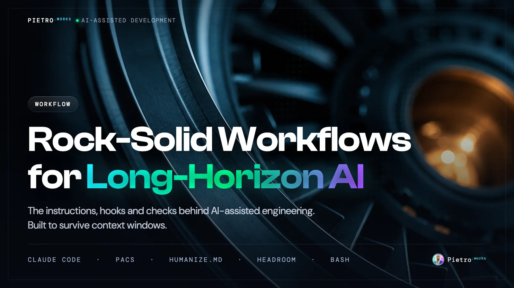
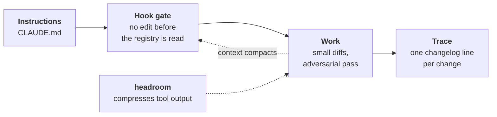
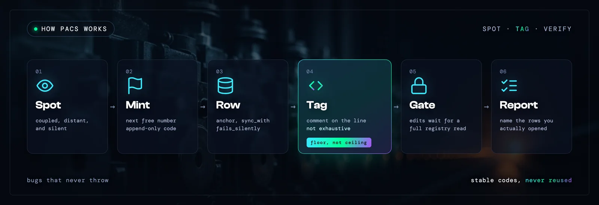
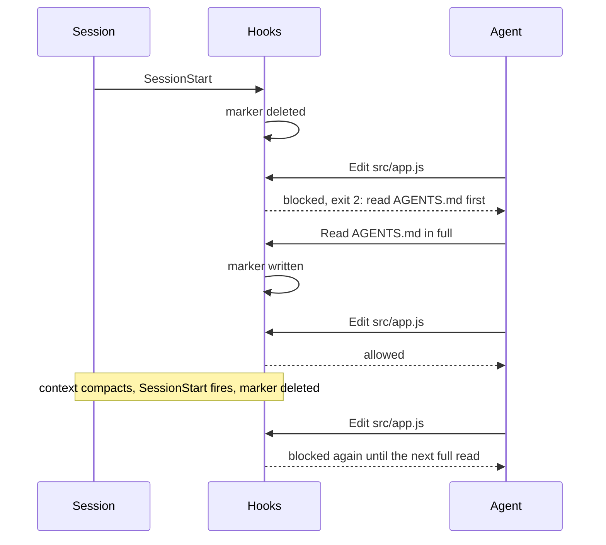
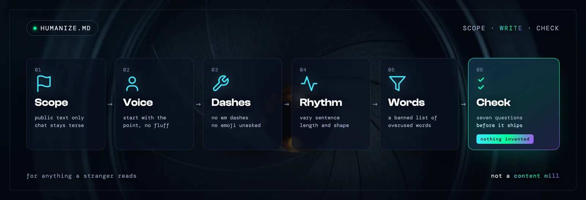
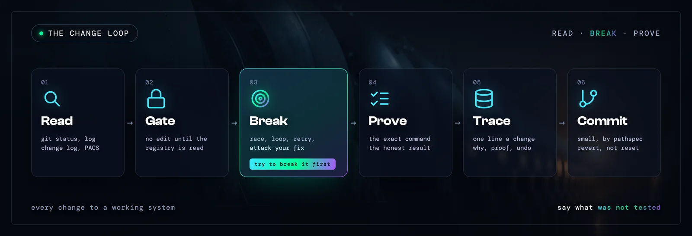
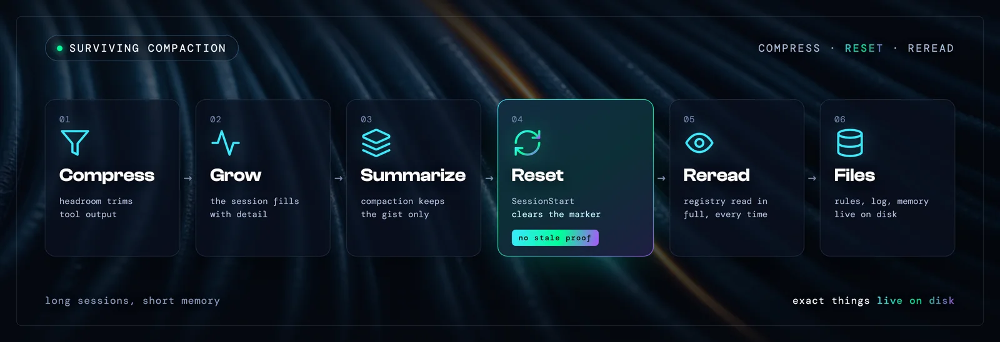

<p align="center">
  
</p>

<table>
<tr>
<td width="120" valign="middle"></td>
<td valign="middle">

**Pietro Impagliazzo**, AI workflow architect in Wrocław, Poland.<br>
The AI-assisted development setup I work with, published as the files it runs on: standing instructions, a hook gate, a coupling linter and a context layer.

</td>
</tr>
</table>

[](https://github.com/pietro-works/Workflow/actions/workflows/ci.yml)
[](LICENSE)
[](#the-setup)
[](https://github.com/pietro-works/PACS)
[](https://humanize.md)
[](install.sh)
[](https://pietro.works)
[](#contact)

[The setup](#the-setup) &nbsp;·&nbsp;
[Components](#the-components) &nbsp;·&nbsp;
[PACS](#pacs) &nbsp;·&nbsp;
[The hooks](#the-hooks) &nbsp;·&nbsp;
[HUMANIZE.md](#humanizemd) &nbsp;·&nbsp;
[Trace](#the-trace) &nbsp;·&nbsp;
[Change loop](#how-changes-get-made) &nbsp;·&nbsp;
[Context](#the-context-stack) &nbsp;·&nbsp;
[Install](#install) &nbsp;·&nbsp;
[Contact](#contact)

---

## The setup

Agents are fast and forgetful. They edit a file without knowing what else depends on it, and a context reset wipes the rules they were following. Some report success on commands they never ran.

This repo is the answer in plain text. Rules load at the start of every session and a hook enforces the one that matters most. A written trace outlives any summary.



| Layer | What it does | Where it lives |
| :--- | :--- | :--- |
| **Standing instructions** | Rules the agent reads before it touches anything | [`instructions/`](instructions), [`components/`](components) |
| **Hook gate** | Blocks edits until the project's registry has been read, and clears that proof on every session start, compaction included | [`hooks/`](hooks), [`pacs/pacs-hooks/`](pacs/pacs-hooks) |
| **Coupling registry** | Numbered couplings that fail silently, tagged at the exact line they govern | [`pacs/`](pacs) |
| **Context layer** | headroom compresses tool output before the model sees it | [`hooks/headroom.hooks.json`](hooks/headroom.hooks.json) |
| **Trace** | A 17-field line per logical change, with the invariant, the proof and the rollback | [`components/change-log.md`](components/change-log.md) |

---

## The components

Ten files hold the text of these components, each with its source unchanged. Nine are cut from [`instructions/CLAUDE.md`](instructions/CLAUDE.md). The tenth is [`HUMANIZE.md`](components/HUMANIZE.md), the original master prompt, copied as it is. A build step fails if any of the nine drifts from its source. The gate has no section in `CLAUDE.md`, so its mechanics are in [`docs/how-it-works.md`](docs/how-it-works.md).

| Component | Its power | Full text |
| :--- | :--- | :--- |
| **[PACS](#pacs)** | Marks the couplings that break quietly, so nobody loses them between sessions | [`pacs.md`](components/pacs.md), [`SPEC.md`](pacs/SPEC.md) |
| **[The gate](#the-hooks)** | Blocks Edit, Write and MultiEdit calls until this project's registry has been read, and resets that proof on each session start | [`how-it-works.md`](docs/how-it-works.md) |
| **[HUMANIZE.md](#humanizemd)** | A full writing standard for anything an outside reader will see | [`HUMANIZE.md`](components/HUMANIZE.md), [humanize.md](https://humanize.md) |
| **[The Trace](#the-trace)** | One 17-field line per change: intent, invariant, proof, rollback | [`change-log.md`](components/change-log.md) |
| **[Adversarial analysis](#how-changes-get-made)** | Try to break your own fix before it ships | [`adversarial-analysis.md`](components/adversarial-analysis.md) |
| **[Three-agent sweep](#how-changes-get-made)** | Debugging and audits run as three agents, each with its own lens | [`three-agent-sweep.md`](components/three-agent-sweep.md) |
| **[Debugging discipline](#how-changes-get-made)** | Reproduce the exact symptom, not a proxy | [`debugging-discipline.md`](components/debugging-discipline.md) |
| **[Git hygiene](#how-changes-get-made)** | Small commits, explicit staging, reversible history | [`git-hygiene.md`](components/git-hygiene.md) |
| **[Context hygiene](#the-context-stack)** | Bounded, parsed diagnostics, with facts kept apart from inference | [`context-hygiene.md`](components/context-hygiene.md) |
| **Tooling and output style** | Structured tools over raw output, and answers that are terse and straight to the point | [`tooling.md`](components/tooling.md), [`output-style.md`](components/output-style.md) |

---

## PACS


**Petrus Agentic Coupling System.** *PACS marks those couplings so nothing is lost between sessions.*

Some bugs announce themselves. The build turns red, a test fails, the app throws. PACS is for the other kind. You add a unit type and forget the sprite table, so it renders as nothing. You rename a field on a message and the far side reads `undefined`, so the request quietly times out. Nothing errors, and weeks later someone asks why the new thing looks broken.

A compiler can't see that coupling, and a test only catches it when someone already knew it was there. That knowledge is what evaporates between sessions, refactors and whoever opens the file next.

<br clear="right">

<p align="center">
  
</p>

### A number, a row and a comment

Each silent coupling gets a stable code, one row in a registry, and the same code written as a comment on the exact line it governs.

```js
// PACS0001 — a new unit type needs matching edits at every keyed-by-type site — AGENTS.md (known sites, not exhaustive)
const UNITS = { worker: {...}, vehicle: {...}, triangle: {...} }
```

```yaml
PACS0001:
  anchor: "engine.js:UNITS"
  sync_with:              # known sites, not exhaustive
    - "atlas.js"
    - "validate.js"
  fails_silently: "new type renders blank, or its orders get dropped before the engine runs"
  justification: "four independent keyed-by-type sites, none derived from UNITS"
```

Edit near the line and the code sends you to the row, which lists the places someone already found. You start from what is known instead of from nothing.

### Why it holds up

| | |
| :--- | :--- |
| **The signpost sits at the edit** | The warning is on the wire you are about to cut, not buried in a doc nobody reopens. |
| **One source of truth** | The registry row names the touch-points someone already found. |
| **A floor, not a ceiling** | A written list of sites reads as a complete one, so every tag says the list is only what is known and the editor greps for the rest. A site found later goes into the row in the same change. |
| **Stable, append-only codes** | `PACS0007` means the same thing next year and in a stranger's clone. A number is never reused. |
| **Small on purpose** | Only load-bearing couplings that fail silently earn a code. If it breaks loudly, the crash already did the job. |

### What the agent has to do

1. **Read the registry before any work, planning included.** Again after any break and after any context compaction. A paraphrase in a summary is not the entry.
2. **Mint in the same change.** The next free number, the YAML row, the tag at the anchor. Then grep for the identifier, its literal value and the underlying field name, because every hit outside the anchor is a touch-point the row must list.
3. **Open the response with `P.A.C.S ✅`** when the registry was genuinely consulted. A checkmark nobody earned makes the signal a lie.
4. **Close with a report line** that names the rows opened and where the touch-points were confirmed. "Opened PACS0001, PACS0014, confirmed touch-points in atlas.js and validate.js, added dispatch.js to PACS0001" can be checked. "codes touched: PACS0001" can't.

### Where it runs

It has three modules. The operating rules live in [`CLAUDE.md`](components/pacs.md). The linter is `pacs check`, `pacs init`, `pacs extract` and `pacs report`, and needs `rg` and `yq`. The gate is the three hooks below, which stop edits until the registry has been read.

The PACS README describes one sweep of a browser game of about seven thousand lines that found twenty-two couplings worth a code. The generator that rendered this README's visuals, [PietroDispatch](https://github.com/pietro-works/PietroDispatch), carries ten of its own, among them one for how deliveries are typed, one for the headless gate of the fluxogram renderer and one for the archive index.

Here, 9 linter tests, 22 path-matching tests and 50 scenario checks run on Linux and macOS in CI.

<table>
<tr>
<td width="50%" valign="top">

**Use it**

```bash
pacs init      # bootstrap a registry in AGENTS.md
pacs check     # run all parity checks
pacs extract   # print the parsed registry
pacs report    # registry summary stats
```

</td>
<td width="50%" valign="top">

**Read more**

- [SPEC.md](pacs/SPEC.md), the convention
- [Source repo](https://github.com/pietro-works/PACS)
- [Registry schema](pacs/schema/pacs-registry.schema.json)
- [Starter template](pacs/templates/AGENTS.md.template)

</td>
</tr>
</table>

---

## The hooks

The full setup wires five hook entries globally in `~/.claude/settings.json`, three from PACS and two from headroom. The installer adds the three PACS ones.

| Owner | Event | Matcher | Script | What it does |
| :--- | :--- | :--- | :--- | :--- |
| PACS | `SessionStart` | all sources | `pacs-reset-marker.sh` | Deletes the "registry was read" marker. Fires on startup, resume, clear and compaction |
| PACS | `PostToolUse` | `Read` | `pacs-mark-read.sh` | Writes the marker, but only for a full read of this project's `AGENTS.md` |
| PACS | `PreToolUse` | `Edit\|Write\|MultiEdit` | `pacs-enforce-read.sh` | Blocks with exit code 2 until the marker exists |
| headroom | `SessionStart` | `startup\|resume` | `headroom init hook ensure` | Runs headroom's own `ensure` check |
| headroom | `PreToolUse` | `Bash` | `headroom init hook ensure` | Same check before shell commands |

A session with the gate looks like this:



The gate costs nothing where PACS isn't used. A project with no `AGENTS.md`, or a registry with zero entries, passes straight through. Details and limits are in [docs/how-it-works.md](docs/how-it-works.md).

---

## HUMANIZE.md

<p align="center">
  
</p>

**A writing standard for agents.** The brief is to read like an experienced, busy, intelligent human, *not an assistant, not a content mill, not a model.*

It exists in three forms. A research report, *The Anatomy of Synthetic Writing*, looks at perplexity and burstiness, at semantic versus episodic memory, and at how flat syntactic chains change the way readers judge authenticity. The master prompt, [`HUMANIZE.md`](components/HUMANIZE.md), is the original file, unchanged, and turns that research into rules an agent can follow. The site at [humanize.md](https://humanize.md) publishes both. Inside this setup the same rules sit under a scope header in `CLAUDE.md`, so they only fire where they should.

### Where it applies

| It governs | It stays out of |
| :--- | :--- |
| README files and docs meant for users | Chat replies, which stay terse |
| Published and marketing copy, release notes, landing pages | Internal docs and handoff notes |
| App store text and public UI copy | Commit messages, code comments, the change log |
| Anything a non-colleague will read | The agent's own planning |

When the audience is unclear, the text is treated as internal and the agent asks first.

### What the ruleset covers

| Rule family | One line from it |
| :--- | :--- |
| **Voice** | Write like a competent person talking to another competent person. Start with the point that matters most. |
| **Punctuation and typography** | Never use em dashes. One semicolon per page at most. No emojis unless the user uses them first. |
| **Rhythm and structure** | Never write three consecutive sentences of similar length and shape. Break "X improves Y, reduces Z, and increases W" into cause and effect. |
| **Banned and restricted vocabulary** | A list of stock words that never appear, and a short list that may appear once per text. |
| **Hedging and certainty** | Do not hedge automatically. When the uncertainty is real, say exactly what is uncertain. |
| **Specificity and grounding** | If a sentence could fit any company, any product, any topic, rewrite it. |
| **Engagement** | No false intimacy, no "Let's dive in!", no cheerleading. |
| **Formatting discipline** | Default to prose. No nested bullets, no random bold, no tables unless comparing real data. |
| **Other guidelines** | Never invent personal experience, clients, anecdotes, numbers, research or results. |

<details>
<summary><b>The banned list</b></summary>

<br>

Never used unless quoting someone:

```text
delve, tapestry, landscape (metaphorical), realm, embark, journey (metaphorical),
unleash, unlock, elevate, supercharge, game-changer, seamless, robust, leverage
(as a verb), holistic, synergy, cutting-edge, ever-evolving, in today's world,
navigate (metaphorical), foster, empower, harness, pivotal, crucial (more than
once), comprehensive, multifaceted, myriad, plethora, testament to, underscores,
boasts, vibrant, bustling, nestled, dive into, it's important to note, it's worth
noting, moreover, furthermore, additionally (as paragraph openers), in this sense,
that being said, needless to say
```

Allowed once per text, and only when it is truly the best word: significant, key, essential, ensure, enhance, streamline, optimize, impactful.

</details>

### The self-check

Run silently before any public text goes out:

1. No em dashes anywhere.
2. No banned vocabulary.
3. No triplet enumerations.
4. Sentence lengths vary visibly.
5. The opening states the point and the ending lands on an implication, not a summary.
6. At least one concrete, situated detail anchors the text.
7. Nothing invented.

Then deliver only the final text, without explaining what was changed. The original file is [`components/HUMANIZE.md`](components/HUMANIZE.md), unchanged.

---

## The Trace

Git history says what changed. It rarely says why this line, what had to stay true, or how it was checked. The Trace is one machine-only line per logical change, written to a local `.change-log.tsv` that never gets committed. The next agent reads it before touching anything, which makes it the cheapest answer to "what was last verified here?"

| Field | Rule |
| :--- | :--- |
| `UTC_ISO`, `OP`, `path` | When, `A`, `M`, `D` or `R`, and the repo-relative file |
| `scope`, `change_id`, `parent_id` | The function or module touched, a stable id for the change, and a group id for multi-file edits |
| `intent` | One to eight terse tokens, no prose |
| `anchor` | A short unique snippet from the changed area, so a later agent can find the spot |
| `before`, `after` | Behavior or state, terse and factual |
| `invariant` | What must remain true |
| `risk` | `low`, `med` or `high` |
| `impact` | One of `behavior`, `ui`, `test`, `docs`, `cleanup`, `deploy`, `safety`, `config`, `data` |
| `verify`, `result` | The exact proof that was run, and `pass`, `fail` or `not-run:<reason>` |
| `rollback`, `comment` | The revert target or mitigation, and a note used only for large or non-obvious edits |

Before changing project files the agent reads the recent entries, and before appending it checks the last non-empty line to detect the schema. Each line stays terse and free of tabs and newlines. A file with several unrelated edits gets several lines, and appends to the log itself are not logged. The full rules are in [`components/change-log.md`](components/change-log.md).

---

## How changes get made

<p align="center">
  
</p>

### Adversarial analysis

*The goal is to never ship a change you have not tried to break yourself.* It applies whenever a change touches an existing, working system, and it skips self-contained new code and trivial edits.

| Step | The move |
| :--- | :--- |
| **1. Investigate before touching** | Read the real code paths end to end and trace the lifecycle across process boundaries, with file and line references. |
| **2. Map the mechanism** | Trigger, each hop, side effects, terminal states. List every consumer of the state being changed, including the ones in other modules. |
| **3. Verify the linchpin** | Find the one or two facts the fix rests on and prove them before building. |
| **4. Try to break it** | Races, false positives and negatives, loops, double effects, cross-instance leaks, resource cost, platform lifecycle, retries and ordering. |
| **5. Redesign if the naive fix is unsound** | Say so plainly. Do not ship the obvious version with a caveat taped on. |
| **6. Minimize blast radius** | Reuse tested primitives. The smallest diff that is actually correct wins. |
| **7. Report honestly** | State exactly what was and was not tested, and how to confirm the rest. |
| **8. Separate fact from inference** | When debugging live, gather ground truth first, and when the evidence contradicts the model, change the model out loud. |

### Three-agent sweep

Debugging and auditing default to launching 3 parallel agents, each with a distinct lens or territory, from integration audits to regression hunts.

- Each agent gets a self-contained prompt with exact paths, and reports `file:line` findings, not impressions.
- The lenses must not overlap. Three copies of the same sweep is waste, not coverage.
- Agent claims are leads. The findings get merged, deduplicated and verified against the real code before anything is fixed.
- It is skipped only for a trivial single-file issue whose cause is already proven, and the skip is stated.

The audits behind this repo ran that way: three agents with separate lenses for privacy, installer correctness and documentation accuracy.

### Debugging discipline

- Before calling a bug fixed, reproduce the user's exact symptom, not a proxy.
- Programmatic checks such as `scrollTo` skip hit-testing and can pass while the real gesture still fails.
- An unexplained number in your own diagnostics is the lead. Chase it.
- Never paste CSS you can't explain mechanically.
- Confirm the scope, mobile or desktop, page or element, before editing.

### Git hygiene

- Run `git status` and read the recent trace before any change. Dirty files are someone else's work until `git diff` says otherwise.
- Keep commits small and logical, and stage with explicit pathspecs.
- Never stage the trace, secrets, scratch files, build output or caches.
- Audit before every commit: `git status --short`, `git diff --check`, `git diff --cached --stat`.
- Use reversible history. Revert pushed commits, restore by path, and never `reset --hard` or force-push without being asked.

---

## The context stack

<p align="center">
  
</p>

Long sessions get summarized, and a summary keeps the gist while losing detail. Three layers cover that, each at a different point.

| Layer | Mechanism | What it protects |
| :--- | :--- | :--- |
| **Before the model** | [headroom](https://github.com/headroomlabs-ai/headroom) runs as a local proxy. By its own description it compresses tool outputs, logs and files before they reach the model | Window space |
| **During compaction** | Claude Code summarizes the session. The `SessionStart` hook then clears the gate marker | Nothing is trusted from before the summary. The registry gets read again before the next edit |
| **Outside the window** | Instructions, registry, changelog and per-project memory files all live on disk | Anything that must be exact survives any summary |

headroom is optional and installs through its own project. Run `./install.sh --apply --with-headroom` to hand off to `headroom init -g claude`. `install.sh` itself never touches the Claude settings that route traffic to the proxy.

The diagnostics rules cover the rest. Check size before reading a log and parse it instead of dumping it. Cap every output, and label each statement a fact or an inference. When investigating, the answer takes one shape that fits a screen: an active-process check, the last relevant timeline, errors and warnings, the likely cause, and a prevention rule.

---

## Standing instructions

[`instructions/CLAUDE.md`](instructions/CLAUDE.md) is the single source of truth, shipped as it sits on disk minus a personal-style section, two machine-specific references in the PACS part and the names of two internal dashboards in the quality bar. [`instructions/AGENTS.md`](instructions/AGENTS.md) holds no rules, only a pointer to it, so tools that look for `AGENTS.md` land in the same place.

<details>
<summary><b>The thirteen sections</b></summary>

<br>

| Section | In one line | Own file |
| :--- | :--- | :--- |
| Production Deploys | Rules for anything that ships to a live server | |
| README And Public Docs Hygiene | Public docs stay product-facing, with no internal operations in them | |
| Public-Facing Writing, Humanization | A writing ruleset for anything an outside reader will see, with a banned-vocabulary list and a self-check | [`HUMANIZE.md`](components/HUMANIZE.md) |
| .change-log.tsv (Machine Trace) | One tab-separated line per logical change, 17 fixed fields | [`change-log.md`](components/change-log.md) |
| Git Hygiene And Revert Safety | Small commits, explicit pathspecs, `git revert` over history rewrites | [`git-hygiene.md`](components/git-hygiene.md) |
| Context Hygiene And Fast Diagnostics | Bounded log reads, parsers instead of dumps, facts apart from inference | [`context-hygiene.md`](components/context-hygiene.md) |
| System Tooling Preferences | `rg`, `fd`, `jq`, `yq`, `gh`, `uv` and friends over raw output | [`tooling.md`](components/tooling.md) |
| Debugging Discipline | Reproduce the user's exact symptom, not a proxy for it | [`debugging-discipline.md`](components/debugging-discipline.md) |
| Three-Agent Sweep | Debugging and audits default to three parallel agents with distinct lenses | [`three-agent-sweep.md`](components/three-agent-sweep.md) |
| Changes To Working Systems | An adversarial pass: trace the real path, then try to break your own fix | [`adversarial-analysis.md`](components/adversarial-analysis.md) |
| PACS | The operating rules for the coupling registry | [`pacs.md`](components/pacs.md) |
| Quality Bar | Research first, then build, then raise it. A first draft is never the deliverable | |
| Output Style | Terse and straight to the point | [`output-style.md`](components/output-style.md) |

</details>

---

## What's in the box

```text
Workflow/
├── install.sh                  dry run by default, --apply to write
├── tests/run.sh                installer and hook-gate checks in a temp HOME
├── LICENSE
├── .github/workflows/ci.yml    tests and shellcheck on Linux and macOS
├── assets/                     the images above, with the generator specs behind them
├── components/                 nine cut from CLAUDE.md, plus the original HUMANIZE.md
├── scripts/build-components.sh builds them and checks they match the source
├── instructions/
│   ├── CLAUDE.md               the global rules, single source of truth
│   └── AGENTS.md               short pointer to CLAUDE.md
├── hooks/
│   ├── settings.hooks.json     the three PACS hooks, template form
│   └── headroom.hooks.json     the two headroom hooks, reference
├── pacs/                       snapshot of github.com/pietro-works/PACS
│   ├── SPEC.md                 the convention
│   ├── bin/pacs                check | init | extract | report
│   ├── lib/                    the checks behind pacs check
│   ├── pacs-hooks/             the three gate scripts
│   ├── schema/                 registry JSON schema
│   └── test/                   fixtures, test runner, hook tests
└── docs/
    ├── how-it-works.md         gate mechanics and known limits
    └── trends.md               what other AI-assisted devs are doing
```

---

## Install

**You need** `bash`, [`jq`](https://jqlang.github.io/jq/), [`rg`](https://github.com/BurntSushi/ripgrep) and [`yq`](https://github.com/mikefarah/yq). headroom is optional.

```bash
git clone https://github.com/pietro-works/Workflow.git
cd Workflow
./install.sh
```

That prints the plan and changes nothing. When it looks right:

```bash
./install.sh --apply
```

The installer adds the three PACS hooks to `~/.claude/settings.json` and keeps whatever hooks are already there. It links `pacs` into `~/.local/bin`, appends the PACS section to `~/.claude/CLAUDE.md` when that file exists and has none, and backs up each file it modifies as `<file>.bak.<timestamp>`. Running it twice adds nothing the second time. Clone to a path without spaces, since hook commands are stored unquoted.

Then bootstrap a project and start a new Claude Code session so the hooks load:

```bash
cd your-project
pacs init
```

<details>
<summary><b>Uninstall</b></summary>

<br>

1. Remove the three entries whose command ends in `pacs-reset-marker.sh`, `pacs-mark-read.sh` and `pacs-enforce-read.sh` from `~/.claude/settings.json`, or restore the `settings.json.bak.<timestamp>` file.
2. Delete the `pacs` link in `~/.local/bin`.
3. Remove the PACS section from `~/.claude/CLAUDE.md`.

</details>

---

## What isn't here

This repo covers the engineering side of the setup. The content-pipeline skills, scheduled tasks, personal settings and anything under `env` stay out. The `headroom` entries are listed for reference, and headroom itself comes from its own project.

How this compares with what other AI-assisted developers are publishing is in [docs/trends.md](docs/trends.md), with sources and the gaps.

---

## Contact

<table>
<tr>
<td valign="top" width="50%">

**Pietro Impagliazzo**<br>
Wrocław, Poland

[pietro.works](https://pietro.works)<br>
[github.com/pietro-works](https://github.com/pietro-works)<br>
[linkedin.com/in/pietro-works](https://www.linkedin.com/in/pietro-works/)<br>
[humanize.md](https://humanize.md)

</td>
<td valign="top" width="50%">

**Other public work**

[**PietroDispatch**](https://github.com/pietro-works/PietroDispatch) reads the day's AI news, picks the three stories worth posting and writes each one twice.<br>
[**AIWars**](https://github.com/pietro-works/AIWars) has two LLMs command pixel armies on a 24x14 grid, in the browser with no build step.<br>
[**SocSim**](https://github.com/pietro-works/SocSim) is an agent-based model of cooperation, crime and inequality.

</td>
</tr>
</table>

---

<p align="center">
MIT licensed. PACS snapshot taken from commit <code>b4a3277</code>.<br>
Visuals rendered with the PietroDispatch generators from the Pietro.works design standard. Specs are in <a href="assets"><code>assets/</code></a>.
</p>
